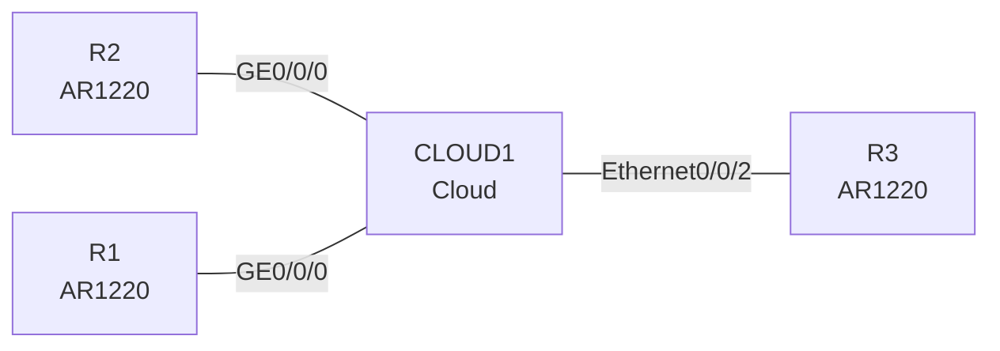

# 2-1Single-Area OSPF —— 拓扑分析

- 设备总数：**4**（AR1220 × 3、Cloud × 1）
- 链路总数：**3**

## 设备清单

| 设备名 | 型号 | Console 端口 | 接口数 |
|---|---|---|---|
| CLOUD1 | Cloud | — | 3 |
| R1 | AR1220 | 2000 | 10 |
| R2 | AR1220 | 2001 | 10 |
| R3 | AR1220 | 2002 | 10 |

## 连线清单

| 源设备 | 源接口 | 目的设备 | 目的接口 | 链路类型 |
|---|---|---|---|---|
| R2 | GE0/0/0 | CLOUD1 | Ethernet0/0/3 | Copper |
| R1 | GE0/0/0 | CLOUD1 | Ethernet0/0/1 | Copper |
| CLOUD1 | Ethernet0/0/2 | R3 | GE0/0/0 | Copper |

## 拓扑示意

