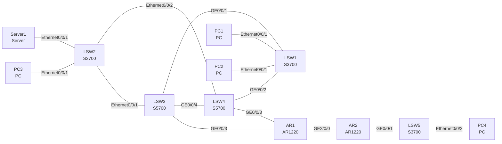

# enterprise-campus —— 拓扑分析

- 设备总数：**12**（AR1220 × 2、PC × 4、S3700 × 3、S5700 × 2、Server × 1）
- 链路总数：**14**

## 设备清单

| 设备名 | 型号 | Console 端口 | 接口数 |
|---|---|---|---|
| AR1 | AR1220 | 2000 | 11 |
| AR2 | AR1220 | 2001 | 10 |
| LSW1 | S3700 | 2002 | 24 |
| LSW2 | S3700 | 2003 | 24 |
| LSW3 | S5700 | 2004 | 24 |
| LSW4 | S5700 | 2005 | 24 |
| LSW5 | S3700 | 2006 | 24 |
| PC1 | PC | — | 1 |
| PC2 | PC | — | 1 |
| PC3 | PC | — | 1 |
| PC4 | PC | — | 1 |
| Server1 | Server | — | 1 |

## 连线清单

| 源设备 | 源接口 | 目的设备 | 目的接口 | 链路类型 |
|---|---|---|---|---|
| LSW3 | GE0/0/3 | AR1 | GE0/0/0 | Copper |
| LSW4 | GE0/0/3 | AR1 | GE0/0/1 | Copper |
| LSW3 | GE0/0/4 | LSW4 | GE0/0/4 | Copper |
| AR2 | GE0/0/1 | LSW5 | Ethernet0/0/1 | Copper |
| LSW5 | Ethernet0/0/2 | PC4 | Ethernet0/0/1 | Copper |
| PC1 | Ethernet0/0/1 | LSW1 | Ethernet0/0/10 | Copper |
| PC2 | Ethernet0/0/1 | LSW1 | Ethernet0/0/11 | Copper |
| LSW3 | GE0/0/1 | LSW1 | Ethernet0/0/1 | Copper |
| LSW4 | GE0/0/2 | LSW1 | Ethernet0/0/2 | Copper |
| PC3 | Ethernet0/0/1 | LSW2 | Ethernet0/0/10 | Copper |
| Server1 | Ethernet0/0/1 | LSW2 | Ethernet0/0/11 | Copper |
| LSW2 | Ethernet0/0/1 | LSW3 | GE0/0/2 | Copper |
| LSW2 | Ethernet0/0/2 | LSW4 | GE0/0/1 | Copper |
| AR1 | GE2/0/0 | AR2 | GE0/0/0 | Copper |

## 拓扑示意

